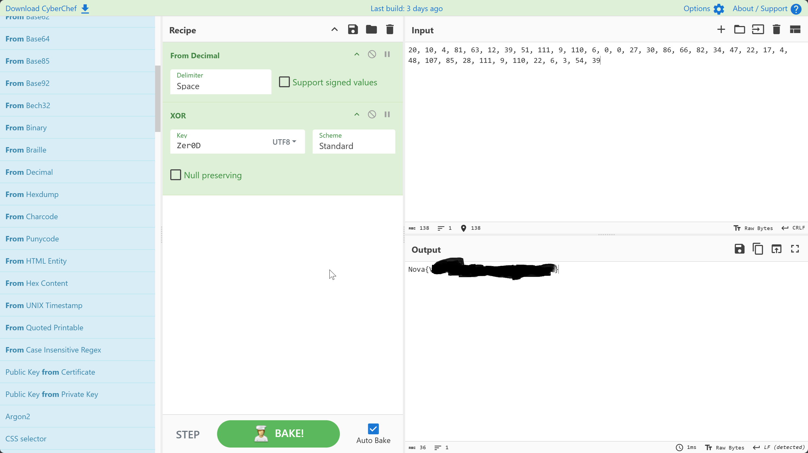

# CV tiềm năng — Malicious Macro Analysis

- **Category**: MalDoc / Reverse Engineering
- **Target**: Tệp tin văn bản `CV.docm`

---

## 1. Nhận diện tệp và phân tích tĩnh

Khi tải tệp về, ta nhận thấy tệp có định dạng mở rộng `.docm` (Word Macro-Enabled Document). Định dạng này cho phép nhúng mã VBA (Visual Basic for Applications), là một vector tấn công phổ biến.


Sử dụng công cụ `olevba` trong bộ OLETools để phân tích tĩnh mã nguồn VBA nhúng bên trong:

```bash
olevba CV.docm
```


---

## 2. Giải mã chuỗi Obfuscation

Quan sát luồng code VBA được trích xuất, ta phát hiện mảng payload số nguyên đã được mã hóa bằng thuật toán XOR với khóa bí mật là chuỗi ký tự `Zer0D`.

Viết script Python ngắn để đảo ngược quá trình mã hóa XOR:

```python
payload = [
    20, 10, 4, 81, 63, 12, 39, 51, 111, 9, 110, 6, 0, 0, 27, 30, 
    86, 66, 82, 34, 47, 22, 17, 4, 48, 107, 85, 28, 111, 9, 110, 
    22, 6, 3, 54, 39
]
key = "Zer0D"

flag = "".join(chr(b ^ ord(key[i % len(key)])) for i, b in enumerate(payload))
print("Flag:", flag)
```

Chạy script giải mã và thu được cờ hoàn chỉnh:


